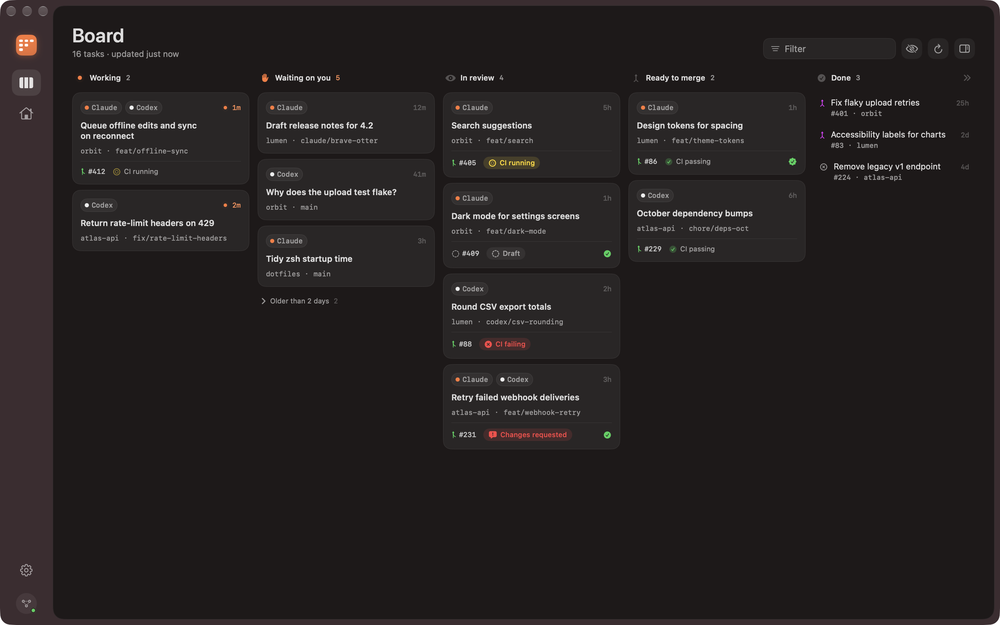
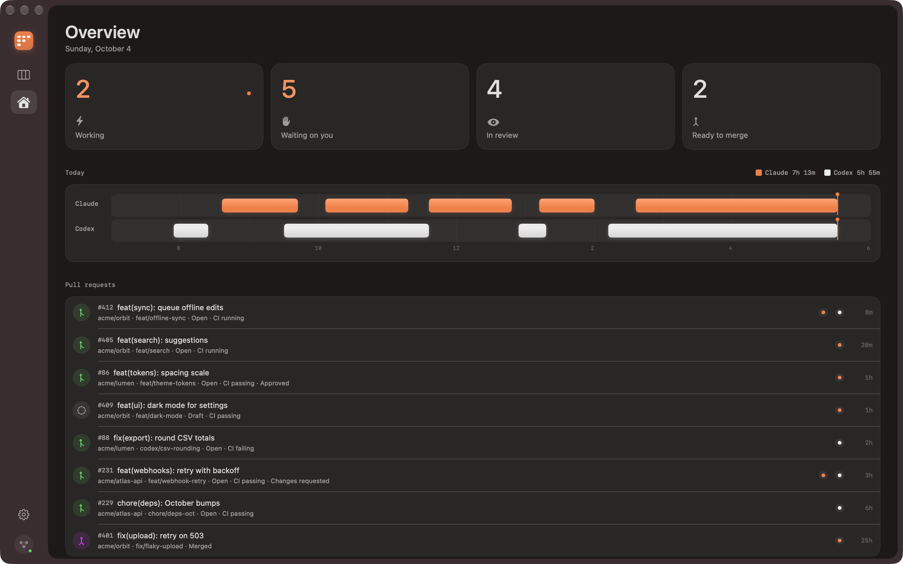
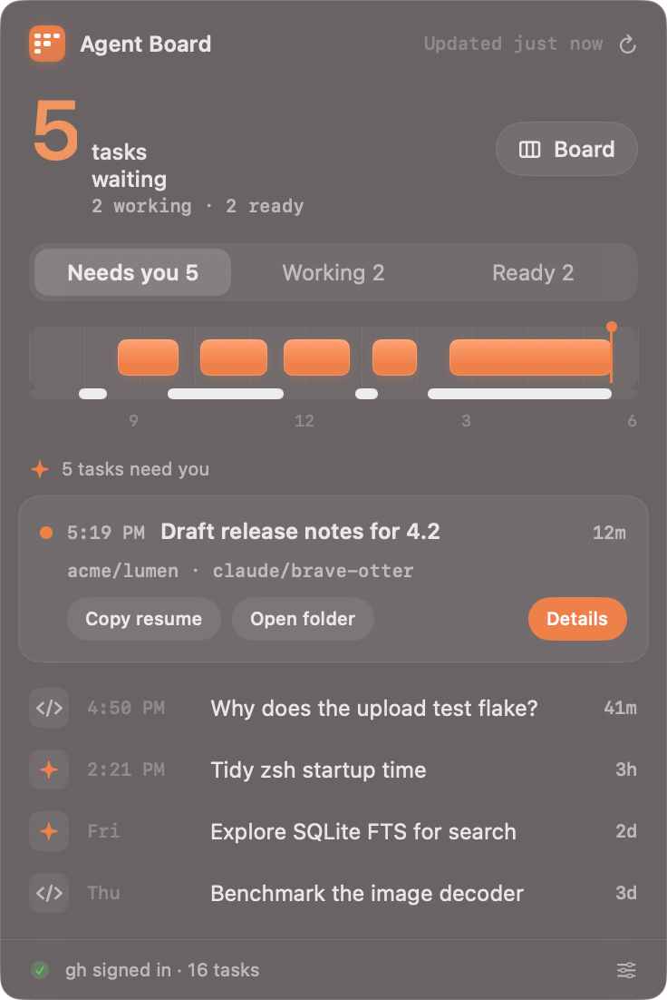

# Agent Board

A native macOS app that shows your Claude desktop and Codex desktop sessions as a
kanban board: one card per repository and branch, with the pull request, CI and
review state for each. There's a main window (Board, Overview, Settings) and a menu
bar panel.



| Overview | Menu bar panel |
| --- | --- |
|  |  |

More in [docs/screenshots](docs/screenshots), in dark and light mode. They use synthetic
demo data, captured from the running app with `Scripts/snapshots.sh` over the app's own
synthetic backdrop. The window under capture isn't key, so switches and prominent
buttons show their inactive-window style.

## Requirements

- macOS 26 or later (built and tested on macOS 27 with Xcode 27 / Swift 6.4)
- The [GitHub CLI](https://cli.github.com), signed in (`gh auth login`), for PR data.
  The board still works without it.

## Build, test and run

Everything runs from the command line. There's no Xcode project; it's a Swift package.

```bash
swift test                      # unit tests (core module, synthetic fixtures)
Scripts/build-app.sh            # builds build/Agent Board.app (release)
open "build/Agent Board.app"    # launch
```

Other commands:

```bash
swift run agentboard-check            # read-only: print what the board sees on this Mac
swift run agentboard-check --json     # same, as JSON
Scripts/build-app.sh debug            # debug build of the app bundle
Scripts/make-icon.sh                  # regenerate Resources/AppIcon.icns from IconArt.swift
Scripts/snapshots.sh <dir> --demo --appearance dark   # screenshot every screen
```

Launch options (pass after `--args` with `open`, or directly to the binary):
`--demo` uses synthetic data and never touches disk or GitHub, `--appearance dark|light`
forces an appearance, and `--verbose` logs refreshes.

## What it reads

Everything is read-only. Agent Board never writes to, moves or deletes anything in
these folders.

| Source | Path | What's used |
| --- | --- | --- |
| Claude sessions | `~/Library/Application Support/Claude/claude-code-sessions/*/*/local_*.json` | title, archived, times, cwd, git roots, PRs the app linked |
| Claude transcripts | `~/.claude/projects/<encoded cwd>/<cliSessionId>.jsonl` | the **tail** only: latest `gitBranch`, turn state, today's activity |
| Codex threads | `~/.codex/state_<n>.sqlite`, table `threads` (highest `n`) | name or title, cwd, branch, origin URL, archived, times |
| Codex rollouts | `~/.codex/sessions/YYYY/MM/DD/rollout-*.jsonl` | the **tail** only: `task_started` / `task_complete` |
| GitHub | `gh pr list` | per repo, every refresh: the 100 most recently updated PRs and all open PRs |

Details that matter:

- **Tails only.** Transcripts are read from the end: 256 KB for state, 2 MB for
  sessions active today (for the timeline), growing to at most 8 MB only if a single
  huge line hides everything. Parsed results are cached by file size and modification
  date, so unchanged files aren't read again.
- **SQLite without side effects.** When Codex's database has no `-wal` file (or an
  empty one), it's opened `SQLITE_OPEN_READONLY` with `immutable=1`: no locks, and no
  `-wal`/`-shm` files created. While Codex is writing (non-empty `-wal`), even a
  read-only connection would update the `-shm` index, so instead the database and its
  WAL are copied to a private temporary folder, read, and deleted.
- **git** is used read-only to find a folder's remote and default branch
  (`git config --get-regexp`, `git symbolic-ref`, `git rev-parse`), with
  `GIT_OPTIONAL_LOCKS=0`. Folders with no branch and no remote are skipped, which also
  keeps git out of privacy-protected folders such as `~/Documents`.
- **Refresh.** FSEvents watches the session folders, and changes are coalesced into a
  local re-read (about 40 ms with warm caches). GitHub is polled every 60 seconds by
  default (configurable), and on demand with ⌘R.
- **Network.** The app reaches the network only through `gh`, using your existing
  login. No tokens are read or stored. No telemetry, analytics or update checks.

## Board rules

A **task** is one (repository, branch). Claude and Codex sessions on the same branch
share a card. Sessions on the default branch, with no branch, or outside any
repository each get their own card. Archived sessions are hidden unless
**Show archived** is on.

| Column | Rule |
| --- | --- |
| Working | A session's turn is running (and it wrote within the last 10 minutes) |
| Waiting on you | The turn ended and there's no PR |
| In review | Open PR that is a draft, has failing or running CI, has changes requested, or is awaiting a required review. The card says which. |
| Ready to merge | Open PR, approved or no review required, CI green (or no CI) |
| Done | PR merged or closed in the last 7 days. Older ones leave the board. |

How turn state is read (checked against the real files on this Mac):

- **Claude:** a finished turn ends with a `system` line whose `subtype` is
  `stop_hook_summary`, or an assistant message with `stop_reason: end_turn`.
  A running turn ends with a user prompt, a tool result, or an assistant `tool_use`.
  Bookkeeping lines (`last-prompt`, `custom-title`, `mode`, …), sub-agent
  (`isSidechain`) lines and meta lines are ignored. "Request interrupted by user"
  ends a turn.
- **Codex:** the last `event_msg` of type `task_started` (running) versus
  `task_complete` or `turn_aborted` (ended).
- When the tail can't tell, activity in the last 3 minutes counts as Working.

PRs are matched by `headRefName == branch`. A cross-repo PR (from a fork) only matches
when the fork belongs to the checkout's `origin` owner, so someone else's fork with
the same branch name never matches. If the checkout has an `upstream` remote, PRs
opened there from your fork match too. Open PRs win over closed ones. The Claude app
also records the PRs a session opened (`prs` in its metadata). Those PRs keep their
card after the checkout moves to another branch; such a card never shows as Working,
since the session is busy elsewhere.

## Actions

All actions are in the card's context menu, the details panel, the **Task** menu and
VoiceOver actions:

- Open pull request (⌘O); open folder in Finder, Terminal or your default code editor (⇧⌘O)
- Copy resume command (⇧⌘C): `cd <folder> && claude --resume <cliSessionId>` or
  `cd <folder> && codex resume <thread id>`. The `cd` is there because Claude looks up
  sessions per project folder. The Codex syntax was checked with `codex resume --help`.
- Copy branch name (⌥⌘C), hide or show card (⌘⌫, stored locally)
- **Mark ready for review…** and **Merge…** (⇧⌘M) run `gh pr ready` / `gh pr merge`.
  Each opens a confirmation sheet that names the PR and shows the exact command.
  Merges offer only the methods the repo allows and pass `--match-head-commit`, so
  nothing merges if new commits were pushed after you looked.

Keyboard: ⌘1 Board, ⌘2 Overview, ⌘, Settings, arrow keys move between cards, Return
toggles details, Esc closes them, ⌥⌘I shows details, ⇧⌘H shows hidden cards.

## Design

The design follows Apple's Human Interface Guidelines and the references in
`design/references/`:

- **Main window**, after the translucent overview window: behind-window vibrancy, an
  icon rail, an inset content panel with continuous corners, large titles, stat cards.
- **Menu bar panel**, after the SystemOS panel: a big count, a segmented control, a
  two-lane timeline (Claude blocks above a thin Codex bar), a callout with inline
  actions, and dense rows with right-aligned durations.
- **Tactile controls**, after the sequencer: one warm orange accent on charcoal, soft
  rounded pads, small monospaced labels. The app icon is a three-column board of
  orange and white pads.

Principles applied:

- Dark first, light mode supported.
- Semantic colours only for CI and review state (green, red, amber, purple for
  merged). Claude is orange and Codex is white (black in light mode), on badges and
  the timeline.
- SF Pro for UI and SF Mono for branches, counts and timestamps. Hairline separators,
  sentence case, restrained motion.

Accessibility:

- Every card, row and control has a VoiceOver label (for example "Queue offline edits,
  acme/orbit, branch feat/offline-sync, Claude and Codex, Working, active 4 minutes
  ago, pull request 412, Open, CI running"), and cards expose the actions as VoiceOver
  custom actions.
- Full keyboard navigation (see above).
- Reduce Motion turns off the pulse, slide and spring animations.
- Reduce Transparency switches panels and cards to opaque fills; system materials
  handle themselves.
- Text uses system text styles.

## Layout

```
Sources/AgentBoardCore/    readers, model, board rules, GitHub client (no UI; unit tested)
  Readers/                 ClaudeReader, ClaudeTranscript, CodexReader
  Git/                     RepoResolver (git behind the GitRunning protocol)
  GitHub/                  GHRunning protocol, GHCLI, GitHubClient, PRParsing, PRMatcher,
                           GitHubWriter + WriteActionCoordinator (confirmation-gated writes)
  Board/                   BoardBuilder, BoardRules, Timeline
  Engine/                  RefreshEngine (actor), FileWatcher (FSEvents)
  Demo/                    synthetic demo data
Sources/AgentBoard/        SwiftUI app
Sources/agentboard-check/  read-only real-data check
Tests/AgentBoardCoreTests/ unit tests and synthetic fixtures
Scripts/                   build-app.sh, make-icon.sh, snapshots.sh
```

## Testing

`swift test` runs 101 tests. All fixtures are synthetic: hand-written JSON and JSONL
modelled on the real formats, with a Codex database built at test time. The tests
cover:

- Claude and Codex readers, including tail-only reading of a 6 MB transcript,
  malformed lines, missing files and "can't read" states
- repo and branch resolution (remote URL forms, forks, worktrees, no remote)
- column rules, task grouping, PR matching and gh JSON parsing
- write actions: they reach only the fake `gh`, and only after confirmation
- a full refresh leaves the fixture folders byte-for-byte unchanged, and the SQLite
  reader creates no `-wal`/`-shm` files
- the file watcher

`swift run agentboard-check` compares nothing by itself; it prints what Agent Board
reads on this Mac so it can be checked against the apps and GitHub.

## Known limitations

- **Permission prompts look like work.** A Claude turn waiting for tool permission
  looks the same in the transcript as a running tool. After 10 minutes without writes
  it moves to "Waiting on you".
- **Branches come from the session.** Many sessions run in a repo's main checkout, so
  their branch is whatever that checkout had checked out at the time (Claude: the
  latest transcript line; Codex: when the thread started). Unrelated threads that
  happened to share a branch share a card.
- **GitHub.com only.** PRs are looked up for github.com remotes only. Other hosts show
  without PR data.
- **Busy repos.** PR coverage is the 100 most recently updated PRs plus up to 200 open
  ones. A branch whose PR finished long ago and was untouched since shows as "Waiting
  on you" until you archive the session or hide the card.
- **Launch from Finder or `open`.** Running the binary directly from a shell doesn't
  receive the launch event, so the main window may not open; use `open` or the menu
  bar item.
- **Undocumented formats.** Both apps' formats are internal. Parsing is tolerant, and
  a format change shows a "can't read …" state in Settings and on the board rather
  than a crash.
