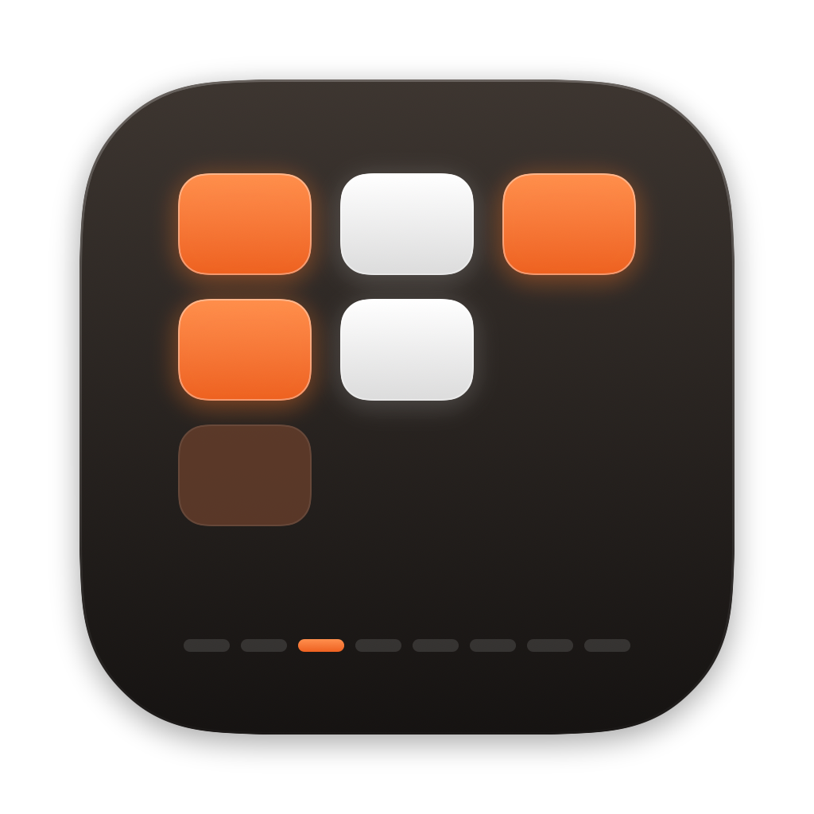
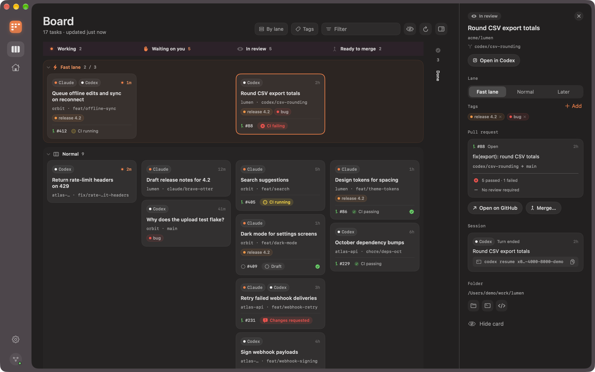
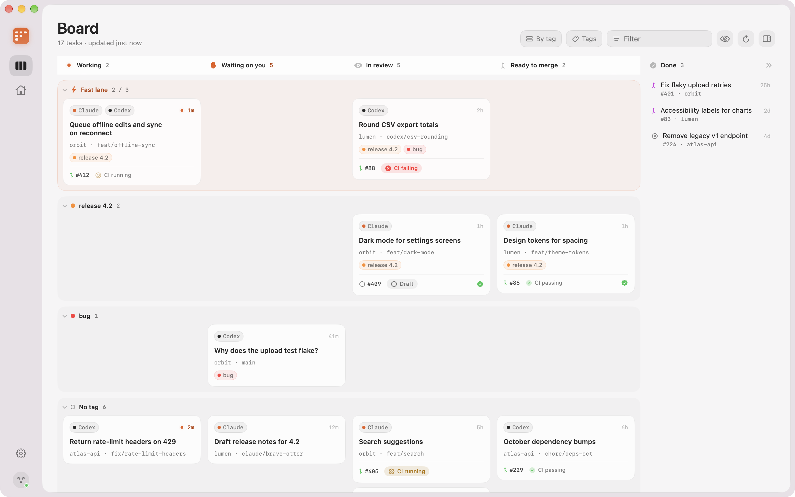
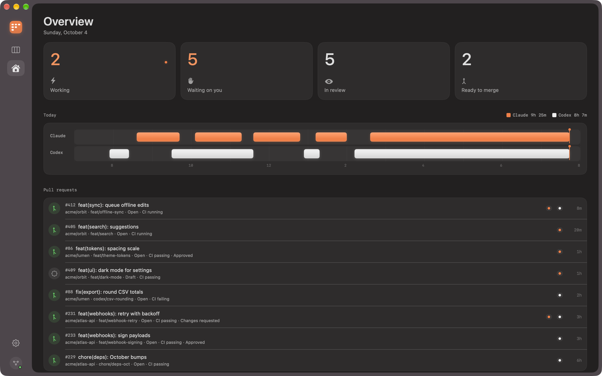
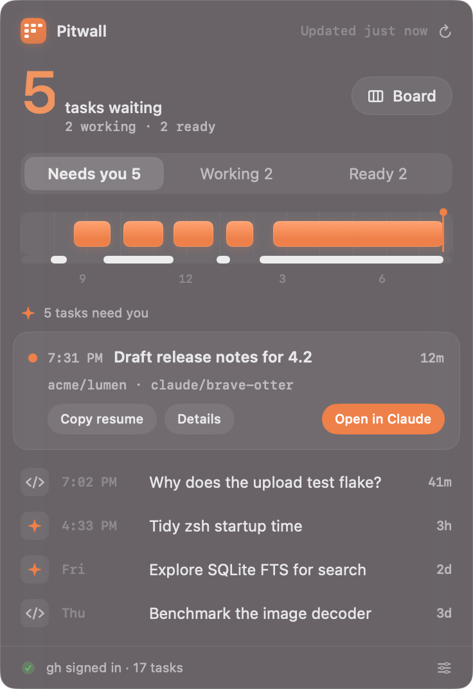
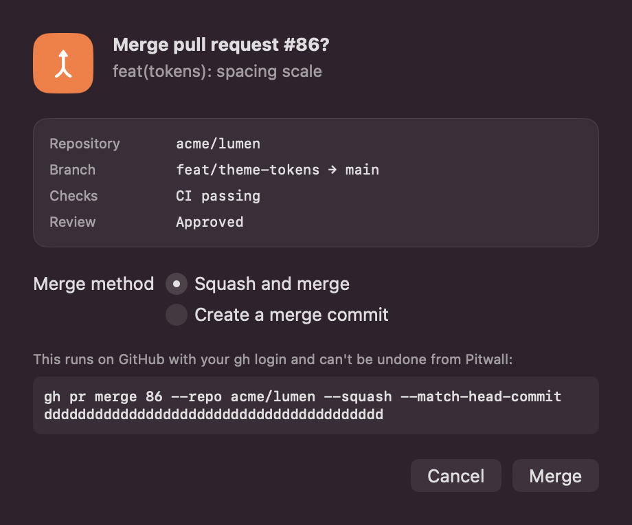
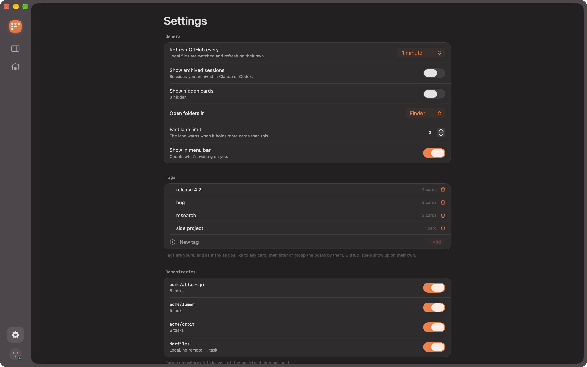
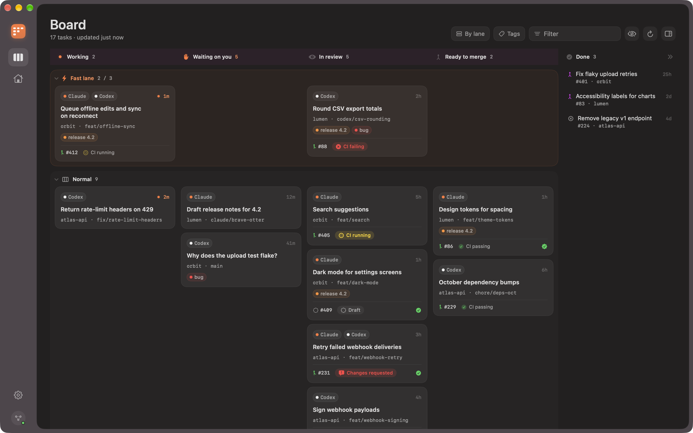

<p align="center">
  
</p>

<h1 align="center">Pitwall</h1>

<p align="center">
  A pit wall for your coding agents.<br>
  See every Claude and Codex session as a task on one board, with its pull request, CI and review state.
</p>

<p align="center">
  macOS 26+ · Swift 6.2 · SwiftUI · MIT
</p>



If you run several coding agents at once, the hard part is knowing which one needs
you. Pitwall reads the session data of the **Claude desktop app** and the **Codex
desktop app**, groups sessions into tasks (one per repository and branch), and shows
them on a kanban board next to each task's GitHub pull request. It runs as a window
and as a menu bar panel, reads everything locally, and never writes to either app's
data.

## Features

- **One card per task.** Claude and Codex sessions on the same branch share a card.
- **Automatic columns.** Working, Waiting on you, In review, Ready to merge and Done,
  from each agent's turn state and the PR's draft, CI and review state.
- **Stacked PRs understood.** A stack moves through the board as one piece of work, and
  only its bottom PR shows as ready to merge.
- **Lanes and tags.** A fast lane for what's urgent, Later for parking, as many tags as
  you like, GitHub labels, filtering by any or all tags, and grouping by lane, tag or
  repository.
- **Actions.** Open a session in Claude or Codex, open the PR or folder, copy the resume
  command, and mark ready or merge through `gh`, behind a confirmation that shows the
  exact command.
- **Menu bar panel.** How many tasks are waiting on you, today's activity, and one-click
  jumps back into the session.
- **Native and accessible.** SwiftUI with system materials, dark and light mode,
  VoiceOver labels and actions, full keyboard control, Reduce Motion and Reduce
  Transparency.

## Screenshots

| | |
| --- | --- |
|  |  |
| Grouped by tag, light mode | Overview: counts and today's activity |
|  |  |
| Menu bar panel | Every GitHub write is confirmed first |
|  |  |
| Settings, with each data source's status | Lanes: fast lane, normal, later |

Screenshots use the built-in demo data (`--demo`).

## Install

Pitwall builds from source with the Swift toolchain; no Xcode project is needed.

Requirements:

- macOS 26 or later and the Xcode command-line tools. The package targets Swift 6.2;
  it's built and tested with Xcode 27 (Swift 6.4).
- The [GitHub CLI](https://cli.github.com), signed in with `gh auth login`, for PR data.
  The board works without it.

```bash
git clone https://github.com/afadil/pitwall.git
cd pitwall
make run          # builds build/Pitwall.app and opens it
```

`make app` builds the bundle without opening it. Copy `build/Pitwall.app` to
`/Applications` to keep it. The bundle is ad-hoc signed; on first launch macOS may ask
you to confirm opening it.

Try it without your own data:

```bash
open build/Pitwall.app --args --demo
```

## Using it

### Columns

Columns are automatic. You never drag a card between them.

| Column | When |
| --- | --- |
| Working | A session's turn is running, or another PR in the same stack is being worked on ("via #N") |
| Waiting on you | The turn ended and there's no PR |
| In review | The PR is a draft, CI is failing or running, changes were requested, a review is required, or it's stacked on another open PR |
| Ready to merge | The PR is approved or needs no review, and CI is green or absent |
| Done | The PR was merged or closed in the last 7 days |

Sessions on the default branch, without a branch, or outside a repository get a card of
their own. Archived sessions are hidden unless you turn on **Show archived**.

### Lanes and tags

Rows are yours. **Fast lane** sits on top and warns when it holds more than its limit
(3 by default). **Normal** is where cards start. **Later** is collapsed, for parking.
Drag a card to another lane, or use the context menu, the details panel or ⌃1 / ⌃2 / ⌃3.
Moving one PR of a stack moves the whole stack.

Add tags from a card's context menu, the details panel or Settings. **Tags** in the
toolbar filters by one or more tags or GitHub labels, matching any or all of them.
**By lane** switches the rows to grouping by tag or repository.

### Keyboard

| Keys | Action |
| --- | --- |
| ⌘1 / ⌘2 / ⌘, | Board / Overview / Settings |
| Arrow keys | Move between cards |
| Return, ⌘↓, double-click | Open the session in Claude or Codex |
| Space | Show or hide details |
| ⌘O / ⇧⌘O | Open pull request / folder |
| ⇧⌘C / ⌥⌘C | Copy resume command / branch name |
| ⌃1 / ⌃2 / ⌃3 | Move to Fast lane / Normal / Later |
| ⇧⌘M | Merge… (asks first) |
| ⌘⌫ | Hide or show the card |
| ⌘R | Refresh |

## Privacy and safety

- **Read-only on agent data.** Pitwall never writes to, moves or locks anything in
  `~/.claude`, `~/Library/Application Support/Claude` or `~/.codex`. Transcripts are read
  from the end only. Codex's SQLite database is opened read-only and immutable, so no
  `-wal` or `-shm` files are created next to it.
- **Network only through `gh`.** No telemetry, analytics or update checks. No tokens
  are read or stored.
- **Writes only on confirmation.** Mark ready and merge show the exact `gh` command
  first, and merges pass `--match-head-commit`.
- **What it stores.** Preferences in macOS user defaults, and your lanes, tags and
  hidden cards in `~/Library/Application Support/Pitwall/organization.json`. Nothing else.

## How it works

Pitwall reads each app's internal, undocumented files, so parsing is tolerant: a format
change shows a "can't read …" state in Settings and on the board instead of a crash.

| Source | Path | Used for |
| --- | --- | --- |
| Claude sessions | `~/Library/Application Support/Claude/claude-code-sessions/*/*/local_*.json` | Title, archived, times, folder, PRs the app linked |
| Claude transcripts | `~/.claude/projects/<folder>/<cliSessionId>.jsonl` (tail) | Current branch, turn state, today's activity |
| Codex threads | `~/.codex/state_<n>.sqlite`, table `threads` | Name, folder, branch, remote, archived, times |
| Codex rollouts | `~/.codex/sessions/YYYY/MM/DD/rollout-*.jsonl` (tail) | Turn state, today's activity |
| GitHub | `gh pr list`, per repository | PR state, CI checks, review decision, labels |

[docs/architecture.md](docs/architecture.md) covers the data flow, turn-state detection,
PR matching, stacks and the write-confirmation design. [docs/spec.md](docs/spec.md) is
the original brief.

## Development

```bash
make test          # unit tests
make lint          # swift-format, strict
make format        # apply swift-format
make check         # print what the board reads on this Mac (read-only)
make screenshots   # regenerate docs/screenshots from demo data
make icon          # regenerate the app icon from Design/IconArt.swift
```

The code is split into `PitwallCore` (readers, rules, GitHub, storage; no UI, unit
tested) and the `Pitwall` SwiftUI app (thin views over `AppModel`). `git` and `gh`
sit behind protocols, so tests use fakes and never touch GitHub. Test fixtures are
synthetic. See [AGENTS.md](AGENTS.md) for the rules this project keeps.

The app accepts a few launch options for demos and screenshots: `--demo`,
`--appearance dark|light` and `--verbose` (logs refreshes).

## Known limitations

- **Permission prompts look like work.** A Claude turn waiting for tool permission
  looks like a running tool in the transcript; after 10 minutes without writes it moves
  to Waiting on you.
- **Branches come from the session.** In a shared checkout, a session's branch is
  whatever was checked out when it last wrote (Claude) or when it started (Codex).
- **GitHub.com only.** Other hosts appear without PR data.
- **Busy repositories.** PRs come from the 100 most recently updated plus up to 200
  open ones per repository.
- **Launch with `open` or Finder.** Running the binary directly skips the launch event,
  so the main window may not appear.

## Acknowledgements

The design follows Apple's Human Interface Guidelines and takes cues from a compact
dark menu bar time tracker, a step-sequencer concept with a warm orange accent, and
translucent overview windows. Claude and Codex are products of their respective
owners; Pitwall is an independent project that reads their local data.

## License

[MIT](LICENSE)
