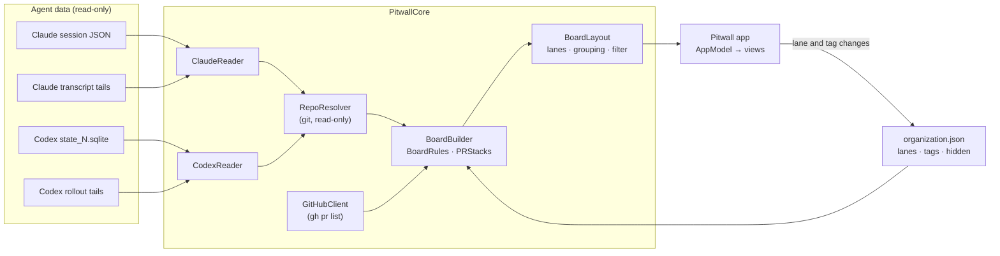

# Architecture

Pitwall is a Swift package with three targets:

| Target | Kind | What it holds |
| --- | --- | --- |
| `PitwallCore` | library | Readers, the board model and rules, git and GitHub access, storage. No UI, fully unit tested. |
| `Pitwall` | executable (SwiftUI app) | Windows, menu bar panel, settings. Thin views over `AppModel`. |
| `pitwall-check` | executable (CLI) | Prints what the board sees on this Mac, read-only. Used to compare against the apps and GitHub. |

`Scripts/build-app.sh` wraps the `Pitwall` executable into an ad-hoc signed `.app`.

## Data flow



1. **Read** (`RefreshEngine.readLocal`): `ClaudeReader` and `CodexReader` turn each
   app's files into `AgentSession` values. `RepoResolver` maps each session's folder
   to a `RepoID` and default branch.
2. **Fetch** (`RefreshEngine.fetchGitHub`): one `GitHubClient` call pair per
   repository with sessions on a non-default branch.
3. **Build** (`BoardBuilder.build`): group sessions into `BoardTask`s (one per repo
   and branch), match PRs, place each task in a column, detect stacks, and apply
   lanes, tags and hidden flags from `Organization`.
4. **Lay out** (`BoardLayout.rows`): split the visible tasks into rows by lane, tag
   or repository. Views render rows × columns.

`AppModel` (main actor, `@Observable`) owns the snapshots and rebuilds the board
whenever local data, GitHub data, settings or organization change. Rebuilding is
cheap and pure; only reading and fetching touch the disk or network.

## Refresh loop

| Trigger | What runs |
| --- | --- |
| FSEvents on the session folders (`FileWatcher`), coalesced for 1.2 s | `refreshLocal` |
| Every refresh interval (60 s by default) | `refreshLocal`, then `refreshGitHub` |
| A new repository appears in local data | `refreshGitHub` for the new repos |
| Every 20 s | `rebuild` (relative times, stalled-turn detection) |
| ⌘R | both refreshes |

Readers cache parsed results by file size and modification date, so a refresh after
one transcript changes re-reads one tail. A warm local refresh takes about 40 ms.

## Reading without side effects

| Source | How it's read |
| --- | --- |
| Claude session files | `Data(contentsOf:)` |
| Transcripts and rollouts | `TailReader`: `FileHandle(forReadingFrom:)`, seek near the end, read a bounded window (256 KB, 2 MB for today's sessions, at most 8 MB) |
| Codex database | `ReadOnlySQLite`: `SQLITE_OPEN_READONLY` + `immutable=1` when there's no pending WAL (no locks, no `-wal`/`-shm` created); a private temporary copy when Codex is mid-write |
| git | `GitCLI` with `GIT_OPTIONAL_LOCKS=0`: `config --get-regexp`, `symbolic-ref`, `rev-parse` only |
| Folder changes | FSEvents (passive) |

A test reads a full fixture home and asserts every file's size and modification date
are unchanged afterwards.

## Turn state

`ClaudeTranscript.turnState(of:)` and `CodexRollout.summarize` read the tail from the
end and stop at the first line that decides the state:

- **Claude ended:** `system` / `stop_hook_summary`, assistant `stop_reason: end_turn`,
  or a user "Request interrupted by user" message.
- **Claude running:** a user prompt, a tool result, an assistant `tool_use`, or
  `system` / `api_error` (retrying).
- **Ignored:** bookkeeping lines (`last-prompt`, `custom-title`, `mode`, `cost-state`, …),
  sub-agent lines (`isSidechain`) and meta lines.
- **Codex:** the last `event_msg` of `task_started` (running) or
  `task_complete` / `turn_aborted` (ended).

`BoardRules.isWorking` then treats a running turn as stalled after 10 minutes without
writes to the transcript or its sub-agent sidecar files.

## Repositories, branches and PRs

- **Branch:** the latest `gitBranch` in a Claude transcript tail, or Codex's
  `git_branch`. `HEAD` counts as no branch.
- **Repository:** the `origin` remote (or Codex's `git_origin_url`), normalised by
  `RepoID.fromRemote` from https, ssh and scp-style URLs. A checkout without a remote
  is identified by its main folder, so worktrees group together.
- **PR matching** (`PRMatcher`): `headRefName == branch`; same-repo PRs must be in the
  checkout's repo, and fork PRs only match when the fork belongs to the checkout's
  `origin` owner (covering `upstream` workflows). Open PRs win, then the newest finished.
- **Linked PRs:** the Claude app records the PRs a session opened. Those keep a card
  after the checkout moves to another branch; such cards never count as Working.
- **Stacks** (`PRStacks`): open PRs whose base branch is another open PR's head form a
  stack. A stack is one piece of work: while any card in it is Working, the others are
  too ("via #N"); otherwise only the bottom PR can be Ready to merge.

## GitHub writes

`WriteActionCoordinator.request` only builds a `PendingWrite` (and reads the repo's
allowed merge methods). Nothing runs until `confirm()`, which mints a `Confirmation`
tied to that one pending write; `GitHubWriter.perform` refuses anything else. Merges
pass `--match-head-commit`, so new commits pushed after you looked stop the merge.
Tests run every write path against a fake `GHRunning` and assert nothing reaches it
before confirmation.

## Storage

| File | Contents |
| --- | --- |
| `~/Library/Preferences/com.teymz.pitwall.plist` | `BoardSettings` (JSON in user defaults) and a few view states |
| `~/Library/Application Support/Pitwall/organization.json` | `Organization`: tags, and per card its lane, tags and hidden flag |

`OrganizationStore` writes atomically, decodes tolerantly (malformed parts are
skipped), and moves an unreadable file aside instead of overwriting it. Card entries
are keyed by task id (`github.com/owner/name#branch`, or `session:<app>:<id>` for
default-branch cards) and pruned after 30 days off the board.

## Source layout

```
Sources/PitwallCore/
  Board/      BoardBuilder, BoardRules, BoardLayout, PRStacks, Timeline
  Engine/     RefreshEngine, LocalSnapshot, FileWatcher
  Git/        RepoResolver (git behind GitRunning)
  GitHub/     GHRunner (gh behind GHRunning), GitHubClient, PRParsing, PRMatcher,
              GitHubSnapshot, GitHubWriter, WriteActionCoordinator
  IO/         TailReader, ReadOnlySQLite, ProcessRunner, JSON, Timestamp, FileStamp, Shell
  Model/      AgentSession, Board, PullRequest, RepoID, Settings, SourceStatus, Organization
  Readers/    ClaudeReader, ClaudeSessionMetadata, ClaudeTranscript, CodexReader, CodexRollout
  Storage/    OrganizationStore
  Demo/       DemoData (synthetic, for screenshots and --demo)
Sources/Pitwall/
  App/        PitwallApp, AppCommands, LaunchOptions, SnapshotRunner
  Model/      AppModel (+Actions, +Organization), DemoGH
  Design/     Theme, Semantics, Format, Surfaces, Controls, Badges, Toast, FlowLayout, AppMark, IconArt
  Views/      Window, Board, Inspector, Tags, Overview, Settings, MenuBar
Tests/PitwallCoreTests/   one suite per area, Fixtures/ (synthetic)
```

## Testing

- **Unit tests** (`swift test`) cover readers, tail reading, repo resolution, column
  rules, grouping, PR matching, gh parsing, stacks, lanes and tags, storage, the file
  watcher, and the write-confirmation flow. Fixtures are hand-written JSON and JSONL
  modelled on the real formats; the Codex database is built at test time.
- **Real-data check:** `pitwall-check --json` prints what the board reads, for
  comparison with each app's own data and `gh pr view`.
- **Screenshots:** `make screenshots` launches the app in snapshot mode with demo data
  and captures each window over a synthetic backdrop.
